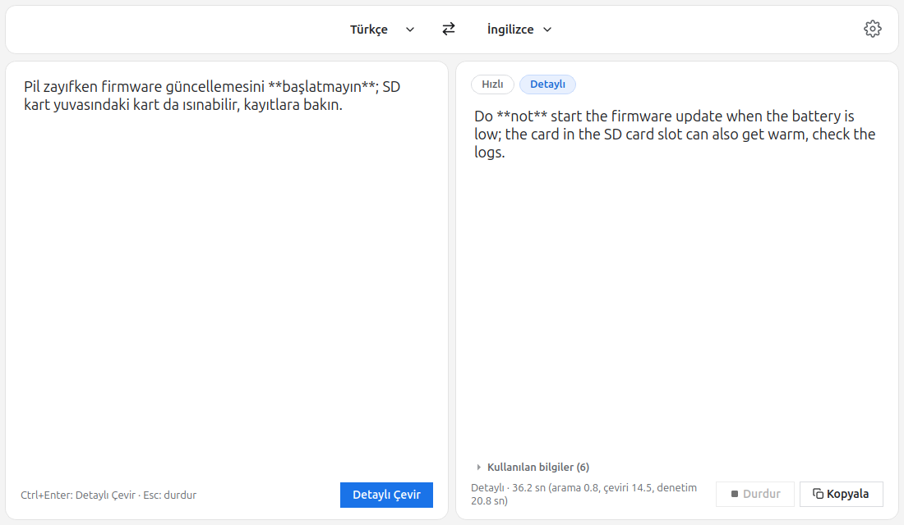
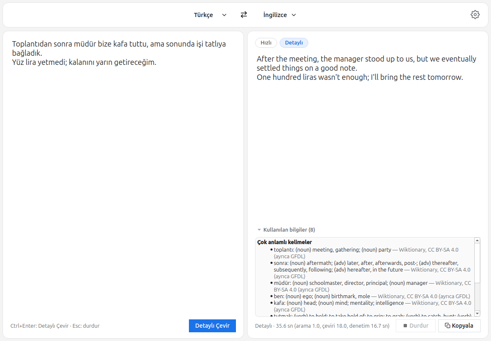
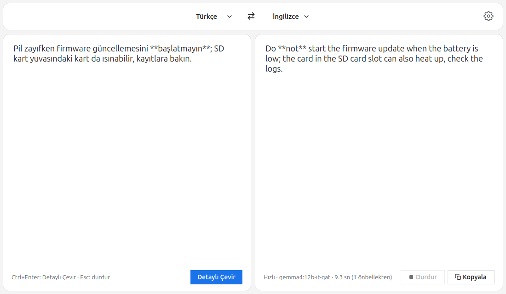

# PolyglotDesk

*Türkçe: [README.tr.md](README.tr.md)*

PolyglotDesk is a **local, offline desktop translator**. It runs a language model on your own computer through [Ollama](https://ollama.com); no text leaves your machine and no internet connection or cloud service is needed while translating. For now it translates only **Turkish ↔ English**.

It works in two stages:

- **Quick translation** (Hızlı çeviri) starts as soon as you paste text and streams the result.
- **Detailed Translation** (Detaylı Çevir) is for when the quick result is not good enough: it looks up idioms, words with several meanings and example sentences in a local dictionary database (Wiktionary + Tatoeba), translates with those hints and then runs a review pass that checks the draft against the source.

The user interface is in Turkish.

## Screenshots

| Detailed Translation | Information used (sources and licences) |
|---|---|
|  |  |
| **Quick translation** (bold moved to the negation word) | **Comparing quick and detailed results** |
|  |  |

## Features

- Fully local: Ollama + `gemma4:12b-it-qat`; no account, no cloud.
- Turkish ↔ English with a direction switch that also swaps the two panels.
- Quick translation starts immediately on paste (1 s after you stop typing), streams word by word, can be stopped, and splits long texts into parts so that only edited parts are translated again.
- Detailed Translation (button or **Ctrl+Enter**) with a local PostgreSQL knowledge pack and a review pass; the review answers in structured form and the code applies only safe corrections.
- "Kullanılan bilgiler" panel shows every dictionary record sent to the model with its source and licence; a switch compares the quick and the detailed result.
- Editable term glossary (`~/.config/cevirmen/sozluk.txt`): technical terms kept in English, fixed translations, and words translated differently only in hardware/electronics context (e.g. *kart* → *board*), with an editable list of the terms that trigger that context. Changes apply without restarting.
- Keeps formatting: line breaks, lists, `inline code`, **bold** and *italic*; emphasis on a negation is moved to the right word in the other language (*not* ↔ the negated Turkish verb) by code.
- Numbers, dates and identifiers are kept as in the source.
- If PostgreSQL is not available, quick translation keeps working.

## Requirements and quick start

- Linux desktop (tested on Ubuntu 26.04), Python ≥ 3.10, PySide6, [Ollama](https://ollama.com) with `gemma4:12b-it-qat` (~7.2 GB download), about 8 GB of free RAM for the model.
- Optional, for Detailed Translation: PostgreSQL and psycopg, ~3.1 GB download and ~566 MB database.

```bash
git clone https://github.com/asunode/PolyglotDesk.git
cd PolyglotDesk
sudo apt install python3-pyside6.qtwidgets python3-pyside6.qtnetwork python3-pyside6.qtsvg python3-psycopg
ollama pull gemma4:12b-it-qat
./calistir.sh
```

Full instructions:

- [doc/install.md](doc/install.md) — base installation (apt or pip / `requirements.txt`, Ollama, CPU-only default, optional TranslateGemma)
- [doc/detailed-setup.md](doc/detailed-setup.md) — Detailed Translation: PostgreSQL, roles, data download and loading, what the database contains

## Speed

Measured on an Intel Core i5-11600K, **CPU only** (no GPU), `gemma4:12b-it-qat`:

| | Per paragraph |
|---|---|
| Quick translation | ~8–24 s (first words after ~3–5 s) |
| Detailed Translation | ~34–70 s |

## Known limitations

- Quick translation was reliable on everyday text in our tests, but it can make mistakes. For important or technical texts use Detailed Translation and check the result.
- Coverage of Turkish idioms is limited: many idioms are not in the data, and some inflected verb forms are not recognised.
- It is slow on a CPU; a GPU that can hold the whole model will be much faster.
- Only Turkish ↔ English for now. Only Ubuntu has been tested.
- The same text can occasionally be translated slightly differently depending on the previous request (an effect of Ollama's prompt cache); see [doc/olcum/tutarlilik-inceleme.md](doc/olcum/tutarlilik-inceleme.md).

## Development stages and tests

Every step was measured; the raw results (in Turkish) are in [`doc/olcum/`](doc/olcum/).

| Step | What was done | Result | Records |
|---|---|---|---|
| 1 | Model selection | 5 installed models measured; `gemma4:12b-it-qat` chosen. On this machine the CPU alone was faster than the old GPU. | [model-karsilastirma.md](doc/olcum/model-karsilastirma.md) |
| 2 | TranslateGemma 12B comparison | Rejected: it reversed the meaning of a technical sentence in 4 out of 4 attempts. | [model-karsilastirma-v2.md](doc/olcum/model-karsilastirma-v2.md) |
| 3 | Quick translation improvements: rules and examples, term glossary, fixed sampling, part-by-part translation | Test set: 11 → 16 passed | [olcum-v3.md](doc/olcum/olcum-v3.md) |
| 4 | Detailed Translation: PostgreSQL knowledge pack (Wiktionary + Tatoeba) and review pass | | [olcum-v4.md](doc/olcum/olcum-v4.md) |
| 5–7 | Three rounds of Detailed Translation | Round 1: worse than quick translation on 4 of 10 texts. Round 2: on 18 texts 8 better / 9 same / 1 worse. Round 3: no serious errors on 26 texts. Each round was measured on a new, previously unseen validation set. | [v1](doc/olcum/detayli-test-v1-sonuc.md), [v2](doc/olcum/detayli-test-v2-sonuc.md), [v3](doc/olcum/detayli-test-v3-sonuc.md) |
| 8 | Everyday topics test (24 texts: 12 speakers/topics × 2 directions) | No negation, number, price or direction errors; 1 model error ("next week" → "hafta sonu", i.e. "weekend"); 1 application error (K6, fixed in step 9); 24 of 24 texts identical in two runs. | [hizli-konu-testi-v1-sonuc.md](doc/olcum/hizli-konu-testi-v1-sonuc.md), [K6 fix](doc/olcum/k6-kontrol-sonuc.md) |

Further studies: [consistency and Ollama's prompt cache](doc/olcum/tutarlilik-inceleme.md), [technical-context rule](doc/olcum/teknik-kural-olcum.md).

Unit tests (no Ollama or PostgreSQL needed):

```bash
python3 -m unittest discover -s tests
```

## Data sources and licences

Detailed Translation uses data from:

- **Wiktionary** (English Wiktionary, via the [kaikki.org](https://kaikki.org/dictionary/rawdata.html) wiktextract extraction) — [CC BY-SA 4.0](https://creativecommons.org/licenses/by-sa/4.0/) (also GFDL).
- **Tatoeba** (Turkish–English sentence pairs, [tatoeba.org](https://tatoeba.org)) — [CC BY 2.0 FR](https://creativecommons.org/licenses/by/2.0/fr/).

The data is **not** included in this repository. It is downloaded and loaded on the user's machine with the loader script (`veritabani/yukle.py`); every record keeps a link to its source and licence, and the application shows them.

The language model (Gemma) is not distributed with the application. It is downloaded through Ollama and is subject to its own licence and terms of use.

## How this project was built

PolyglotDesk was built over two days (18–19 November 2026) by one person working with two AI systems. The roles were:

- **Sinan Kurtoğlu** — idea, direction and every product decision: what to build, which trade-offs to accept, what counted as good enough, and the acceptance of each step. He also tested the application by hand.
- **Claude (Anthropic, Claude Opus 5.5) in a chat conversation** — design and evaluation: proposed the approach (two-stage translation, term glossary, knowledge pack, review pass), wrote the step-by-step instructions given to the coding agent, wrote every test and validation set, and reviewed the raw results of each measurement, including regressions caused by its own instructions.
- **Claude Code (Anthropic, Claude Opus 5.5) on the developer's machine** — implementation: wrote the code, the database loader and the measurement scripts, ran every measurement and kept the development records.

No test text was used to tune the system: each improvement was measured on a new, previously unseen validation set, and the raw results are published in `doc/olcum/`.

All rights to this project belong to Sinan Kurtoğlu.

## License

[MIT](LICENSE) — Copyright (c) 2026 Sinan Kurtoğlu
