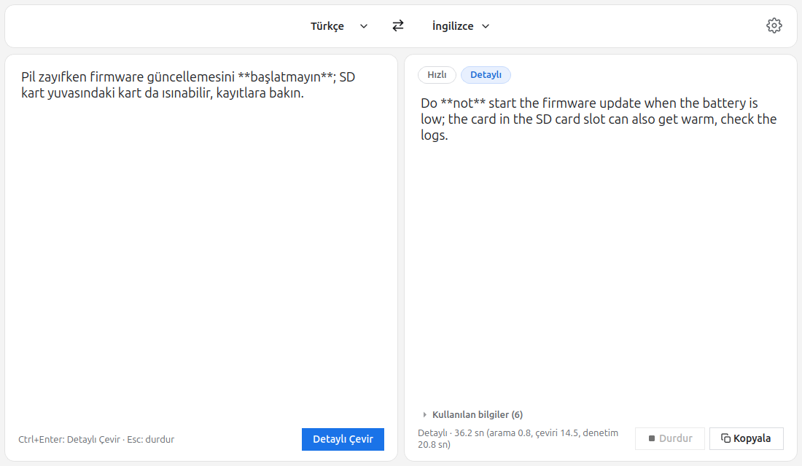
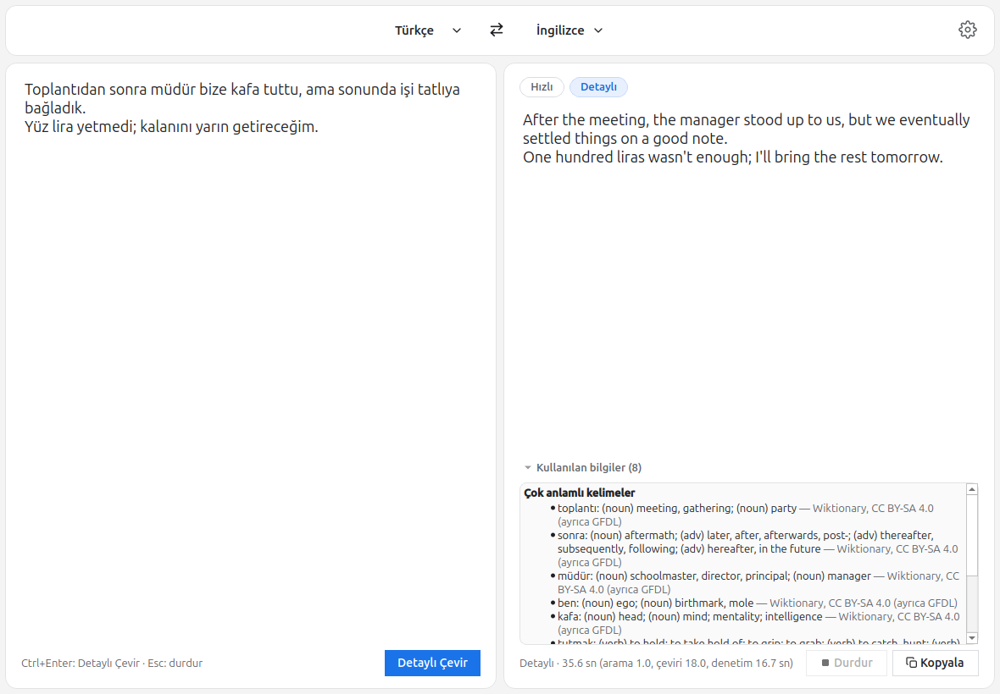
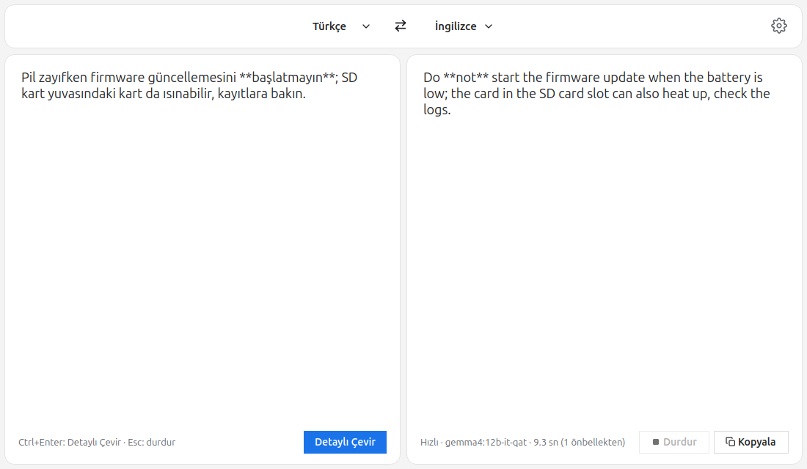

# PolyglotDesk

*English: [README.md](README.md)*

PolyglotDesk **yerel, internetsiz bir masaüstü çevirmenidir**. Dil modelini [Ollama](https://ollama.com) üzerinden kendi bilgisayarınızda çalıştırır; metniniz makinenizden çıkmaz, çeviri sırasında internet bağlantısı ya da bulut hizmeti gerekmez. Şimdilik yalnız **Türkçe ↔ İngilizce** çevirir.

İki aşamada çalışır:

- **Hızlı çeviri**, metni yapıştırır yapıştırmaz başlar ve sonucu akış hâlinde getirir.
- **Detaylı Çevir**, hızlı sonuç yeterince iyi olmadığında kullanılır: yerel bir sözlük veritabanında (Wiktionary + Tatoeba) deyimleri, çok anlamlı kelimeleri ve örnek cümleleri arar, bu ipuçlarıyla çevirir, ardından taslağı kaynakla karşılaştıran bir denetim geçişi yapar.

Arayüz Türkçedir.

## Ekran görüntüleri

| Detaylı Çevir | Kullanılan bilgiler (kaynak ve lisanslar) |
|---|---|
|  |  |
| **Hızlı çeviri** (kalın yazı olumsuzluk kelimesine taşındı) | **Hızlı ve Detaylı sonucun karşılaştırılması** |
|  |  |

## Özellikler

- Tamamen yerel: Ollama + `gemma4:12b-it-qat`; hesap yok, bulut yok.
- Türkçe ↔ İngilizce; yön değiştirme düğmesi iki paneli de takas eder.
- Hızlı çeviri yapıştırınca hemen (yazarken, yazmayı bıraktıktan 1 sn sonra) başlar, kelime kelime akar, durdurulabilir; uzun metinleri parçalara böler, böylece yalnız düzeltilen parça yeniden çevrilir.
- Detaylı Çevir (düğme ya da **Ctrl+Enter**): yerel PostgreSQL bilgi paketi ve denetim geçişi; denetim yapılandırılmış biçimde cevap verir, kod yalnız güvenli düzeltmeleri uygular.
- "Kullanılan bilgiler" bölümü modele giden her sözlük kaydını kaynağı ve lisansıyla gösterir; bir seçiciyle hızlı ve detaylı sonuç karşılaştırılır.
- Düzenlenebilir terim sözlüğü (`~/.config/cevirmen/sozluk.txt`): İngilizce kalacak teknik terimler, sabit karşılıklar ve yalnız donanım/elektronik bağlamında farklı çevrilen kelimeler (ör. *kart* → *board*); bu bağlamı açan terimlerin listesi de düzenlenebilir. Değişiklik yeniden başlatmadan geçerli olur.
- Biçimi korur: satır sonları, listeler, `satır içi kod`, **kalın** ve *italik*; olumsuzluk üzerindeki vurguyu kod öteki dildeki doğru kelimeye taşır (*not* ↔ olumsuz Türkçe fiil).
- Sayılar, tarihler ve tanımlayıcılar kaynaktaki gibi kalır.
- PostgreSQL yoksa hızlı çeviri çalışmaya devam eder.

## Gereksinimler ve hızlı başlangıç

- Linux masaüstü (Ubuntu 26.04'te denendi), Python ≥ 3.10, PySide6, `gemma4:12b-it-qat` modeli kurulu [Ollama](https://ollama.com) (~7.2 GB indirme), model için yaklaşık 8 GB boş bellek.
- İsteğe bağlı, Detaylı Çevir için: PostgreSQL ve psycopg, ~3.1 GB indirme ve ~566 MB veritabanı.

```bash
git clone https://github.com/asunode/PolyglotDesk.git
cd PolyglotDesk
sudo apt install python3-pyside6.qtwidgets python3-pyside6.qtnetwork python3-pyside6.qtsvg python3-psycopg
ollama pull gemma4:12b-it-qat
./calistir.sh
```

Ayrıntılı kurulum:

- [doc/install.tr.md](doc/install.tr.md) — temel kurulum (apt ya da pip / `requirements.txt`, Ollama, yalnız işlemci varsayılanı, isteğe bağlı TranslateGemma)
- [doc/detailed-setup.tr.md](doc/detailed-setup.tr.md) — Detaylı Çevir: PostgreSQL, roller, verinin indirilmesi ve yüklenmesi, veritabanının içeriği

## Süreler

Intel Core i5-11600K, **yalnız işlemci** (GPU yok), `gemma4:12b-it-qat` ile ölçüldü:

| | Paragraf başına |
|---|---|
| Hızlı çeviri | ~8–24 sn (ilk kelimeler ~3–5 sn sonra) |
| Detaylı Çevir | ~34–70 sn |

## Bilinen sınırlar

- Hızlı çeviri testlerimizde gündelik metinde güvenilir çıktı, ama hata yapabilir. Önemli ya da teknik metinlerde Detaylı Çevir'i kullanın ve sonucu kontrol edin.
- Türkçe deyim kapsamı sınırlı: birçok deyim veride yok, bazı çekimli fiil biçimleri tanınmıyor.
- İşlemcide yavaş; modelin tamamını alabilen bir ekran kartıyla çok daha hızlı olur.
- Şimdilik yalnız Türkçe ↔ İngilizce. Yalnız Ubuntu'da denendi.
- Aynı metin, bir önceki isteğe bağlı olarak ara sıra biraz farklı çevrilebilir (Ollama'nın istem önbelleğinin etkisi); bkz. [doc/olcum/tutarlilik-inceleme.md](doc/olcum/tutarlilik-inceleme.md).

## Geliştirme aşamaları ve testler

Her adım ölçüldü; ham sonuçlar [`doc/olcum/`](doc/olcum/) klasöründe.

| Adım | Yapılan | Sonuç | Kayıtlar |
|---|---|---|---|
| 1 | Model seçimi | Kurulu 5 model ölçüldü; `gemma4:12b-it-qat` seçildi. Bu makinede eski GPU yerine yalnız işlemci daha hızlı çıktı. | [model-karsilastirma.md](doc/olcum/model-karsilastirma.md) |
| 2 | TranslateGemma 12B karşılaştırması | Elendi: bir teknik cümlenin anlamını 4 denemenin 4'ünde tersine çevirdi. | [model-karsilastirma-v2.md](doc/olcum/model-karsilastirma-v2.md) |
| 3 | Hızlı çeviri iyileştirmeleri: kurallar ve örnekler, terim sözlüğü, sabit örnekleme, parça parça çeviri | Test setinde 11 → 16 geçti | [olcum-v3.md](doc/olcum/olcum-v3.md) |
| 4 | Detaylı Çevir: PostgreSQL bilgi paketi (Wiktionary + Tatoeba) ve denetim geçişi | | [olcum-v4.md](doc/olcum/olcum-v4.md) |
| 5–7 | Detaylı Çevir'in üç turu | İlk tur, 10 metnin 4'ünde hızlı çeviriden kötüydü; ikinci tur 18 metinde 8 daha iyi / 9 aynı / 1 daha kötü; üçüncü turda 26 metinde ciddi hata yok. Her tur daha önce görülmemiş yeni bir doğrulama setiyle ölçüldü. | [v1](doc/olcum/detayli-test-v1-sonuc.md), [v2](doc/olcum/detayli-test-v2-sonuc.md), [v3](doc/olcum/detayli-test-v3-sonuc.md) |
| 8 | Gündelik konu testi (24 metin, 12 kişi/konu × 2 yön) | Olumsuzluk ya da sayı/fiyat/yön hatası yok; 1 model hatası ("next week" → "hafta sonu"); 1 uygulama hatası (K6, Adım 9'da düzeltildi); 24 metnin 24'ü iki koşuda aynı. | [hizli-konu-testi-v1-sonuc.md](doc/olcum/hizli-konu-testi-v1-sonuc.md), [K6 düzeltmesi](doc/olcum/k6-kontrol-sonuc.md) |

Diğer incelemeler: [tutarlılık ve Ollama istem önbelleği](doc/olcum/tutarlilik-inceleme.md), [teknik bağlam kuralı](doc/olcum/teknik-kural-olcum.md).

Birim testleri (Ollama ya da PostgreSQL gerekmez):

```bash
python3 -m unittest discover -s tests
```

## Veri kaynakları ve lisanslar

Detaylı Çevir şu verileri kullanır:

- **Wiktionary** (İngilizce Vikisözlük, [kaikki.org](https://kaikki.org/dictionary/rawdata.html) wiktextract çıkarımı üzerinden) — [CC BY-SA 4.0](https://creativecommons.org/licenses/by-sa/4.0/) (ayrıca GFDL).
- **Tatoeba** (Türkçe–İngilizce cümle çiftleri, [tatoeba.org](https://tatoeba.org)) — [CC BY 2.0 FR](https://creativecommons.org/licenses/by/2.0/fr/).

Veri bu depoda **yer almaz**. Kullanıcının makinesinde yükleme betiğiyle (`veritabani/yukle.py`) indirilip yüklenir; her kayıt kaynağına ve lisansına bağlı kalır ve uygulama bunları gösterir.

Dil modeli (Gemma) uygulamayla dağıtılmaz. Ollama üzerinden indirilir ve kendi lisansına ve kullanım koşullarına tabidir.

## Bu proje nasıl yapıldı

PolyglotDesk, iki günde (18–19 Kasım 2026) bir kişinin iki yapay zekâ sistemiyle birlikte çalışmasıyla yapıldı. Görevler şöyleydi:

- **Sinan Kurtoğlu** — fikir, yön ve bütün ürün kararları: ne yapılacağı, hangi ödünlerin kabul edileceği, neyin yeterince iyi sayılacağı ve her adımın kabulü. Uygulamayı elle de denedi.
- **Claude (Anthropic, Claude Opus 5.5), sohbet üzerinden** — tasarım ve değerlendirme: yaklaşımı önerdi (iki aşamalı çeviri, terim sözlüğü, bilgi paketi, denetim geçişi), kodlama ajanına verilen adım adım talimatları yazdı, bütün test ve doğrulama setlerini yazdı ve her ölçümün ham sonuçlarını değerlendirdi; kendi talimatlarından kaynaklanan gerilemeler de buna dahil.
- **Claude Code (Anthropic, Claude Opus 5.5), geliştiricinin bilgisayarında** — uygulama: kodu, veritabanı yükleme betiğini ve ölçüm betiklerini yazdı, bütün ölçümleri çalıştırdı ve geliştirme kayıtlarını tuttu.

Sistemi ayarlamak için hiçbir test metni kullanılmadı: her iyileştirme daha önce görülmemiş yeni bir doğrulama setiyle ölçüldü; ham sonuçlar `doc/olcum/` klasöründe yayımlandı.

Bu projenin bütün hakları Sinan Kurtoğlu'na aittir.

## Lisans

[MIT](LICENSE) — Copyright (c) 2026 Sinan Kurtoğlu
